# Revisión de la interfaz de RappiMind v3

Este documento existe para que alguien que no tiene el repositorio ni la app pueda
revisar el copy y la experiencia de RappiMind. Trae una captura de cada pantalla del
recorrido y, debajo, el texto completo que se ve en ella.

- **Cómo se armó.** Se generó la demostración con `npm run demo` y se recorrió
  `demo/index.html` con Playwright. Cada texto se sacó de la pantalla con `innerText`,
  no se copió de los archivos fuente, así que es literalmente lo que lee el comercial.
- **Capturas.** Están en `docs/capturas/revision/`, numeradas en el mismo orden de este
  documento.
- **Campaña de ejemplo.** Un Cashback de Colombia, tienda Farmatodo, 20% con tope de
  $20.000 y presupuesto de $5.000.000, del 1 al 31 de octubre de 2026. Los datos son
  inventados para la demostración.
- **Fecha.** 17 de septiembre de 2026.

## Lo que se repite en todas las pantallas

Esto sale en casi todas las capturas y no se repite en el texto de cada pantalla:

- **Barra superior:** `RappiMind v3` y las secciones `Generar`, `Mis campañas`,
  `Ayuda` y `Administración`. La última solo la ve un administrador.
- **Aviso de la demostración:** "Modo demostración. No se crea ningún documento, no se
  manda ningún correo y nada queda guardado. Al final verás el texto que habría salido."
  Este aviso no existe en la herramienta real.
- **Selector de idioma:** un botón fijo abajo a la derecha con `ES` y `BR`. Cambia el
  idioma de la interfaz, nunca el del documento, que sale siempre en el idioma del país.
- **Vista previa:** en las pantallas del formulario y del resumen, la columna de la
  derecha muestra el documento llenándose, con un contador que dice "Faltan 4 datos" o
  "Completo". El texto del documento se reemplazó aquí por una marca, porque es texto
  legal y no entra en esta revisión.

## Cómo leer el texto de cada pantalla

El texto se extrajo tal cual, línea por línea, así que hay cosas que en la pantalla se
ven distinto:

- En el formulario, las primeras líneas (`Campaña`, `Organizador`, `Cuándo`,
  `Beneficio`, `Créditos`, `Participantes`) son la barra de progreso, no preguntas.
- Debajo van las preguntas ya respondidas, cada una con su enlace `Cambiar` y la
  respuesta. Después viene la pregunta abierta, que es la única que se responde en esa
  pantalla.
- `¿Por qué te preguntamos esto?` es un desplegable. Para esta revisión se abrió en
  todas las pantallas, así que su contenido sale siempre.
- `Así queda en tu T&C` es la frase exacta que esa respuesta escribe en el documento.
- La palabra `Opcional` es una etiqueta al lado del enunciado. En el texto sale pegada
  al enunciado porque así la extrajimos, en la pantalla va separada.
- La última línea de cada pantalla del formulario es el estado de la vista previa:
  `Sin empezar`, `Faltan 4 datos` o `Completo`.

## El recorrido de una mirada

```
inicio
  └─ Empezar ──► filtro de entrada (2 preguntas)
                   ├─ algún sí ──► Legal
                   └─ todo no ──► formulario
                                    país ► negocio ► tipo ► las preguntas del tipo
                                      │
                                      ├─ negocio = Rappi Travel ──► filtro de Travel (9 preguntas)
                                      │                               ├─ algún sí ──► Legal
                                      │                               └─ todo no ──► vuelve al tipo
                                      │
                                      └─ última pregunta ──► resumen ──► Generar ──► listo
Mis campañas y Ayuda están siempre en la barra de arriba.
```

## Las pantallas


### 1. Inicio

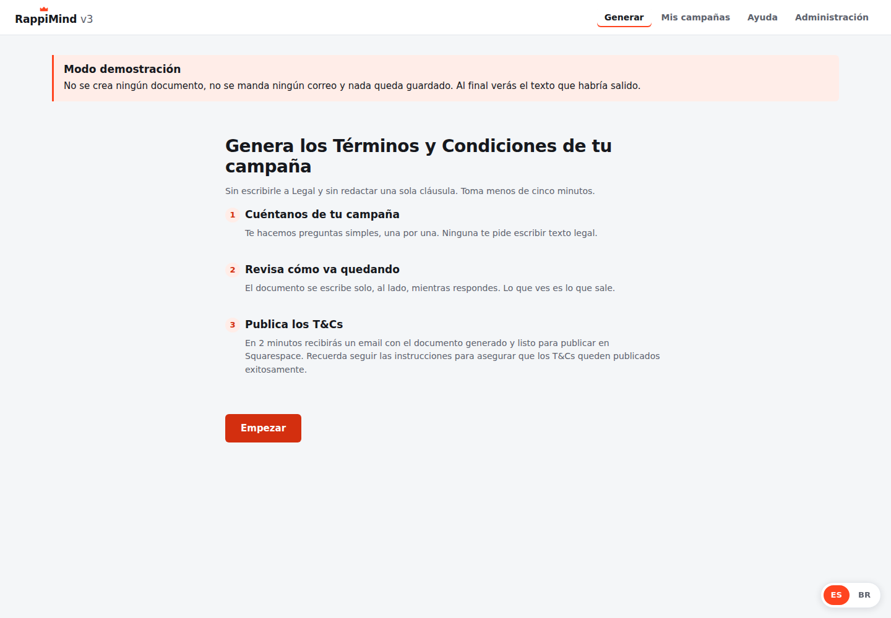

`docs/capturas/revision/01-inicio.png`

**Qué hace el comercial aquí.** Es la primera pantalla. El comercial lee la promesa de la herramienta en tres pasos y decide si arranca una campaña nueva o retoma el borrador que dejó a medias. El botón de seguir el borrador solo aparece si hay algo guardado.

**Lo que dice la pantalla:**

```
Genera los Términos y Condiciones de tu campaña

Sin escribirle a Legal y sin redactar una sola cláusula. Toma menos de cinco minutos.

Cuéntanos de tu campaña

Te hacemos preguntas simples, una por una. Ninguna te pide escribir texto legal.

Revisa cómo va quedando

El documento se escribe solo, al lado, mientras respondes. Lo que ves es lo que sale.

Publica los T&Cs

En 2 minutos recibirás un email con el documento generado y listo para publicar en Squarespace. Recuerda seguir las instrucciones para asegurar que los T&Cs queden publicados exitosamente.

Empezar
```


### 2. Filtro de entrada

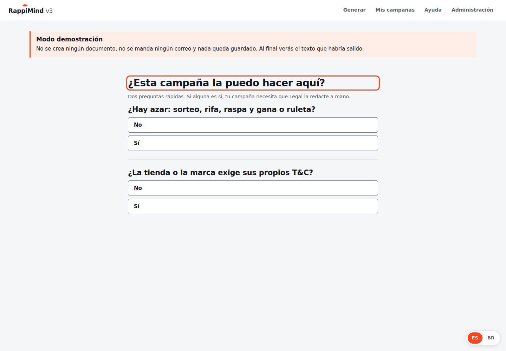

`docs/capturas/revision/02-filtro-de-entrada.png`

**Qué hace el comercial aquí.** Responde dos preguntas generales. Si contesta que sí a cualquiera, la herramienta lo manda a la pantalla de Legal y no sigue. Si contesta que no a las dos, entra al formulario.

**Lo que dice la pantalla:**

```
¿Esta campaña la puedo hacer aquí?

Dos preguntas rápidas. Si alguna es sí, tu campaña necesita que Legal la redacte a mano.

¿Hay azar: sorteo, rifa, raspa y gana o ruleta?
No
Sí
¿La tienda o la marca exige sus propios términos y condiciones?
No
Sí
```


### 3. Formulario, el país

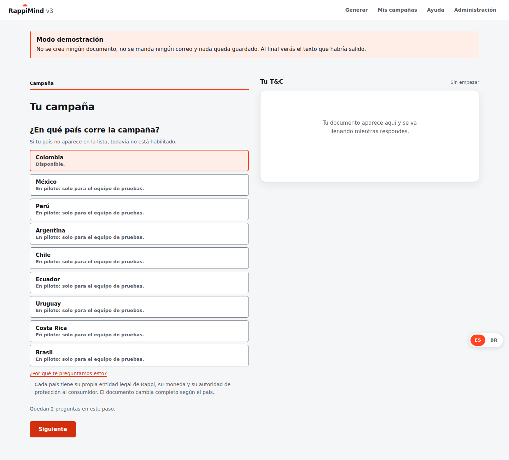

`docs/capturas/revision/03-pregunta-pais.png`

**Qué hace el comercial aquí.** Primera pregunta del formulario. Elige el país de la campaña. Colombia viene marcada, pero la pregunta se muestra igual y él la tiene que confirmar. Los países en piloto lo dicen en la opción.

**Lo que dice la pantalla:**

```
Campaña
Tu campaña
¿En qué país corre la campaña?

Si tu país no aparece en la lista, todavía no está habilitado.

Colombia
Disponible.
México
En piloto: solo para el equipo de pruebas.
Perú
En piloto: solo para el equipo de pruebas.
Argentina
En piloto: solo para el equipo de pruebas.
Chile
En piloto: solo para el equipo de pruebas.
Ecuador
En piloto: solo para el equipo de pruebas.
Uruguay
En piloto: solo para el equipo de pruebas.
Costa Rica
En piloto: solo para el equipo de pruebas.
Brasil
En piloto: solo para el equipo de pruebas.
¿Por qué te preguntamos esto?

Cada país tiene su propia entidad legal de Rappi, su moneda y su autoridad de protección al consumidor. El documento cambia completo según el país.

Quedan 2 preguntas en este paso.

Siguiente
Tu T&C
Sin empezar
[aquí va la vista previa del documento, que no se revisa]
```


### 4. Formulario, el negocio

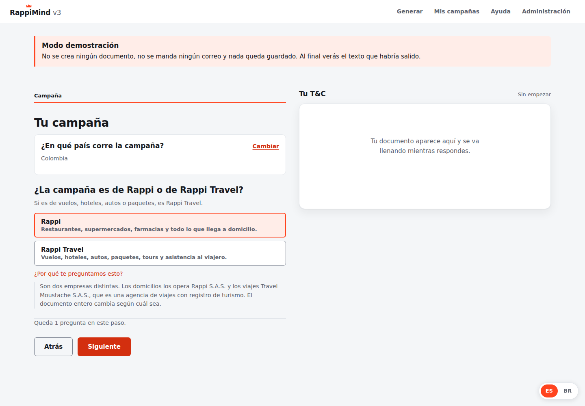

`docs/capturas/revision/04-pregunta-negocio.png`

**Qué hace el comercial aquí.** Dice si la campaña es de Rappi o de Rappi Travel. Es la bifurcación grande del recorrido: elegir Travel lo lleva a otro filtro y a otros tipos de campaña.

**Lo que dice la pantalla:**

```
Campaña
Tu campaña
¿En qué país corre la campaña?
Cambiar

Colombia

¿La campaña es de Rappi o de Rappi Travel?

Rappi es el domicilio de siempre. Rappi Travel son vuelos, hoteles, autos y paquetes.

Rappi
Restaurantes, supermercados, farmacias y todo lo que llega a domicilio.
Rappi Travel
Vuelos, hoteles, autos, paquetes, tours y asistencia al viajero.
¿Por qué te preguntamos esto?

Son dos empresas distintas. Los domicilios los opera Rappi S.A.S. y los viajes Travel Moustache S.A.S., que es una agencia de viajes con registro de turismo. El documento entero cambia según cuál sea.

Queda 1 pregunta en este paso.

Atrás
Siguiente
Tu T&C
Sin empezar
[aquí va la vista previa del documento, que no se revisa]
```


### 5. Formulario, el tipo de campaña de Rappi

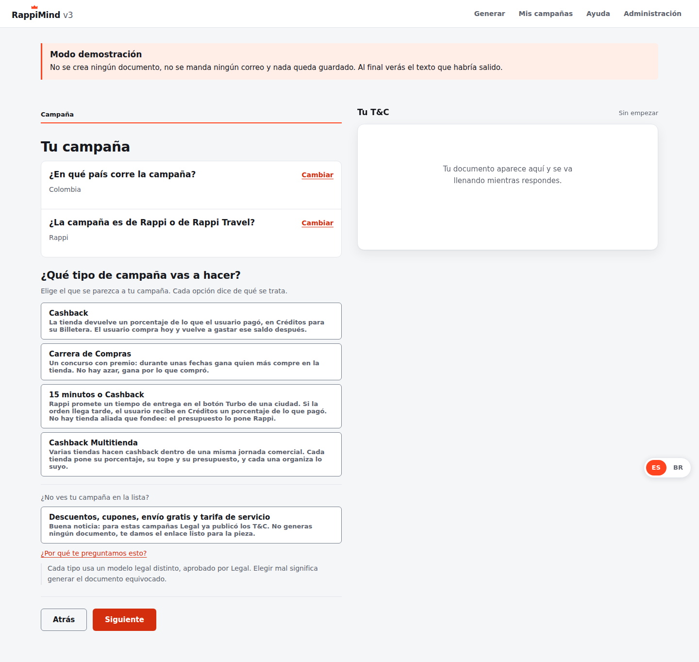

`docs/capturas/revision/05-lista-de-tipos.png`

**Qué hace el comercial aquí.** Elige el tipo de campaña entre tarjetas con nombre y descripción. Los tipos de Travel no aparecen en esta lista.

**Lo que dice la pantalla:**

```
Campaña
Tu campaña
¿En qué país corre la campaña?
Cambiar

Colombia

¿La campaña es de Rappi o de Rappi Travel?
Cambiar

Rappi

¿Qué tipo de campaña vas a hacer?

Elige el que se parezca a tu campaña. Cada opción dice de qué se trata.

Cashback
La tienda devuelve un porcentaje de lo que el usuario pagó, en Créditos para su Billetera. El usuario compra hoy y vuelve a gastar ese saldo después.
Carrera de Compras
Un concurso con premio: durante unas fechas gana quien más compre en la tienda. No hay azar, gana por lo que compró.
15 minutos o Cashback
Rappi promete un tiempo de entrega en el botón Turbo de una ciudad. Si la orden llega tarde, el usuario recibe en Créditos un porcentaje de lo que pagó. No hay tienda aliada que fondee: el presupuesto lo pone Rappi.
Cashback Multitienda
Varias tiendas hacen cashback dentro de una misma jornada comercial. Cada tienda pone su porcentaje, su tope y su presupuesto, y cada una organiza lo suyo.
¿Por qué te preguntamos esto?

Cada tipo usa un modelo legal distinto, aprobado por Legal. Elegir mal significa generar el documento equivocado.

Atrás
Siguiente
Tu T&C
Sin empezar
[aquí va la vista previa del documento, que no se revisa]
```


### 6. Formulario, la tienda

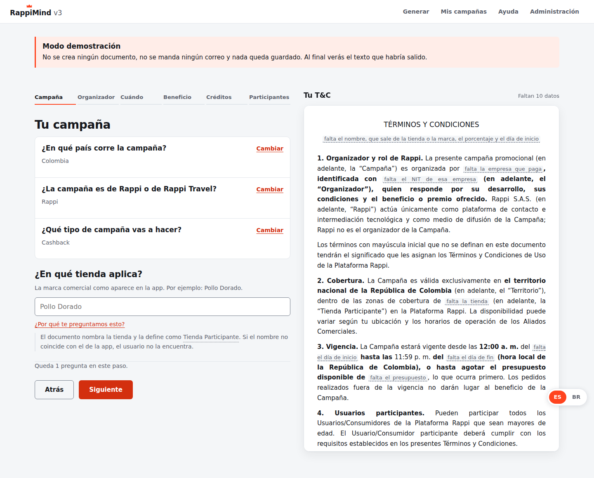

`docs/capturas/revision/06-pregunta-tienda.png`

**Qué hace el comercial aquí.** Escribe la marca comercial de la tienda. Es la primera pregunta después de elegir el tipo, y desde aquí la columna de la derecha empieza a llenarse con el documento.

**Lo que dice la pantalla:**

```
Campaña
Organizador
Cuándo
Beneficio
Créditos
Participantes
Tu campaña
¿En qué país corre la campaña?
Cambiar

Colombia

¿La campaña es de Rappi o de Rappi Travel?
Cambiar

Rappi

¿Qué tipo de campaña vas a hacer?
Cambiar

Cashback

¿En qué tienda aplica?

La marca comercial como aparece en la app. Por ejemplo: Pollo Dorado.

¿Por qué te preguntamos esto?

El documento nombra la tienda y la define como Tienda Participante. Si el nombre no coincide con el de la app, el usuario no la encuentra.

Queda 1 pregunta en este paso.

Atrás
Siguiente
Tu T&C
Faltan 10 datos
[aquí va la vista previa del documento, que no se revisa]
```


### 7. Formulario, la cobertura

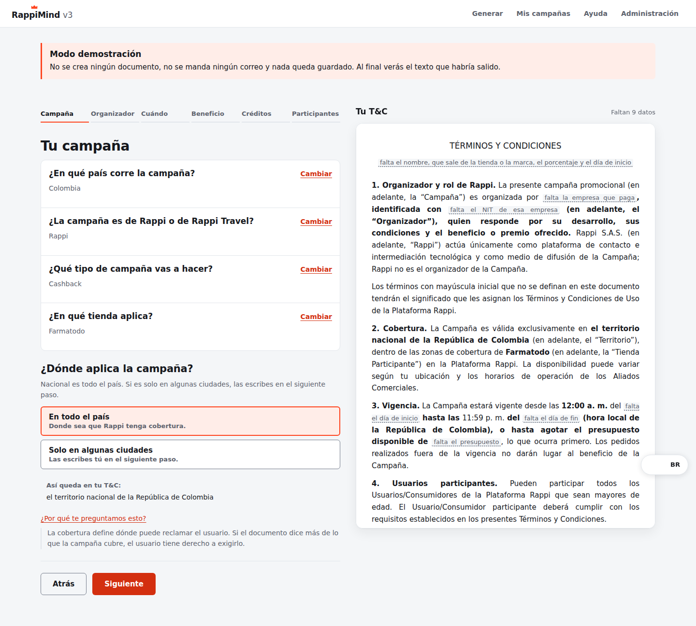

`docs/capturas/revision/07-pregunta-alcance.png`

**Qué hace el comercial aquí.** Dice si la campaña corre en todo el país o solo en algunas ciudades. Aquí aparece por primera vez la línea "Así queda en tu T&C", que le muestra la frase exacta que va al documento.

**Lo que dice la pantalla:**

```
Campaña
Organizador
Cuándo
Beneficio
Créditos
Participantes
Tu campaña
¿En qué país corre la campaña?
Cambiar

Colombia

¿La campaña es de Rappi o de Rappi Travel?
Cambiar

Rappi

¿Qué tipo de campaña vas a hacer?
Cambiar

Cashback

¿En qué tienda aplica?
Cambiar

Farmatodo

¿Dónde aplica la campaña?

Nacional es todo el país. Si es solo en algunas ciudades, las escribes en el siguiente paso.

En todo el país
Donde sea que Rappi tenga cobertura.
Solo en algunas ciudades
Las escribes tú en el siguiente paso.
Así queda en tu T&C:
el territorio nacional de la República de Colombia
¿Por qué te preguntamos esto?

La cobertura define dónde puede reclamar el usuario. Si el documento dice más de lo que la campaña cubre, el usuario tiene derecho a exigirlo.

Atrás
Siguiente
Tu T&C
Faltan 9 datos
[aquí va la vista previa del documento, que no se revisa]
```


### 8. Formulario, quién organiza

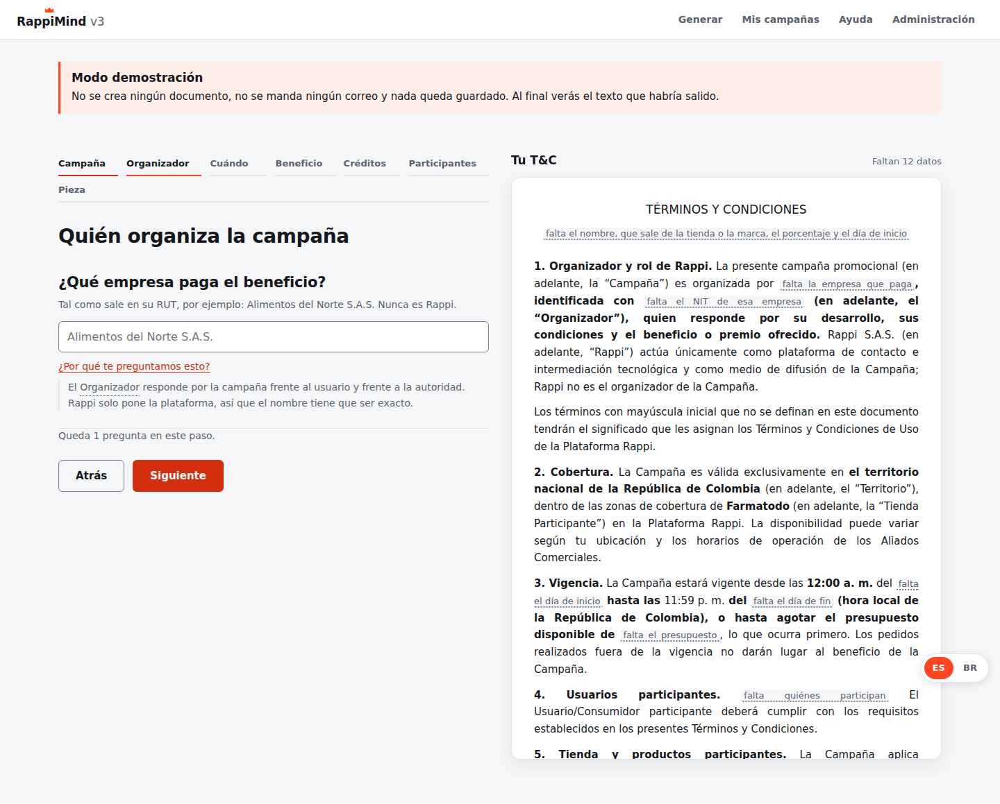

`docs/capturas/revision/08-pregunta-organizador.png`

**Qué hace el comercial aquí.** Escribe la razón social de la empresa que paga el beneficio. Es el Organizador, y nunca es Rappi.

**Lo que dice la pantalla:**

```
Campaña
Organizador
Cuándo
Beneficio
Créditos
Participantes
Quién organiza la campaña
¿Qué empresa paga el beneficio?

Es el Organizador: la tienda o la marca que pone la plata. Nunca es Rappi. Escribe la razón social como aparece en su RUT.

¿Por qué te preguntamos esto?

El Organizador responde por la campaña frente al usuario y frente a la autoridad. Rappi solo pone la plataforma, así que el nombre tiene que ser exacto.

Queda 1 pregunta en este paso.

Atrás
Siguiente
Tu T&C
Faltan 9 datos
[aquí va la vista previa del documento, que no se revisa]
```


### 9. Formulario, la identificación del organizador

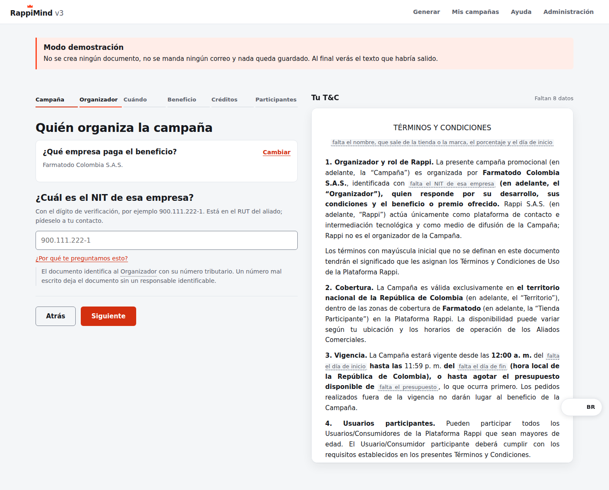

`docs/capturas/revision/09-pregunta-identificacion.png`

**Qué hace el comercial aquí.** Escribe el NIT del organizador. El sistema lo valida y lo muestra formateado como va a quedar en el documento.

**Lo que dice la pantalla:**

```
Campaña
Organizador
Cuándo
Beneficio
Créditos
Participantes
Quién organiza la campaña
¿Qué empresa paga el beneficio?
Cambiar

Farmatodo Colombia S.A.S.

¿Cuál es el NIT de esa empresa?

Con el dígito de verificación, por ejemplo 900.111.222-1. Está en el RUT del aliado; pídeselo a tu contacto.

¿Por qué te preguntamos esto?

El documento identifica al Organizador con su número tributario. Un número mal escrito deja el documento sin un responsable identificable.

Atrás
Siguiente
Tu T&C
Faltan 8 datos
[aquí va la vista previa del documento, que no se revisa]
```


### 10. Formulario, cuándo arranca

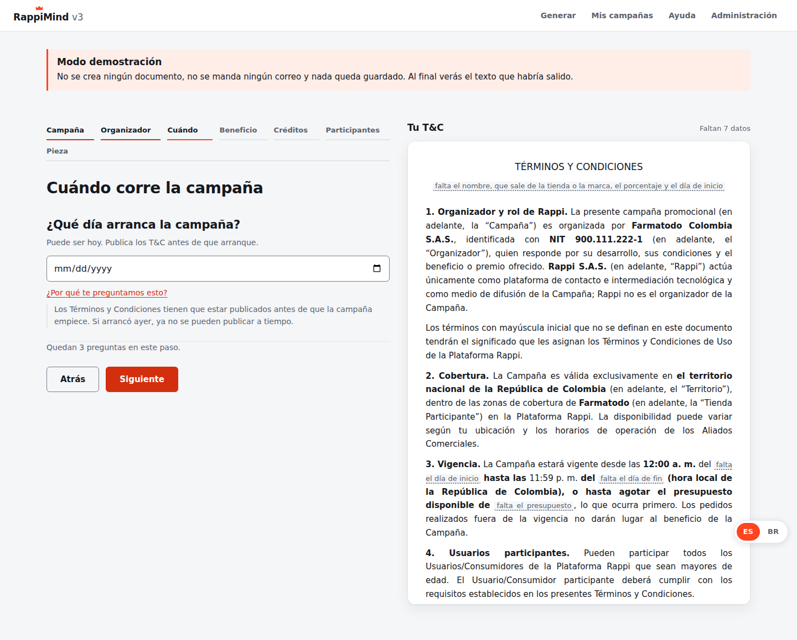

`docs/capturas/revision/10-pregunta-fecha-inicio.png`

**Qué hace el comercial aquí.** Elige el día de inicio de la campaña. Al responderlo, la herramienta propone el mismo día como día de fin.

**Lo que dice la pantalla:**

```
Campaña
Organizador
Cuándo
Beneficio
Créditos
Participantes
Cuándo corre la campaña
¿Qué día arranca la campaña?

Puede ser hoy. Publica los T&C antes de que arranque.

¿Por qué te preguntamos esto?

Los Términos y Condiciones tienen que estar publicados antes de que la campaña empiece. Si arrancó ayer, ya no se pueden publicar a tiempo.

Quedan 3 preguntas en este paso.

Atrás
Siguiente
Tu T&C
Faltan 7 datos
[aquí va la vista previa del documento, que no se revisa]
```


### 11. Formulario, el porcentaje

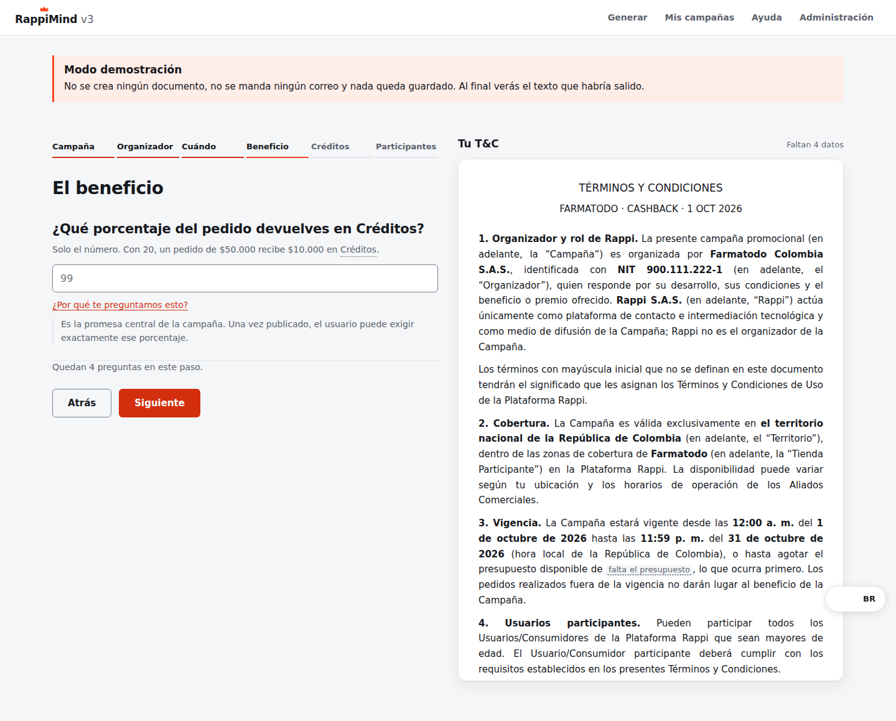

`docs/capturas/revision/11-pregunta-porcentaje.png`

**Qué hace el comercial aquí.** Escribe el porcentaje que la tienda devuelve en Créditos. Es la promesa central de la campaña.

**Lo que dice la pantalla:**

```
Campaña
Organizador
Cuándo
Beneficio
Créditos
Participantes
El beneficio
¿Qué porcentaje del pedido devuelves en Créditos?

Solo el número. Con 20, un pedido de $50.000 recibe $10.000 en Créditos.

¿Por qué te preguntamos esto?

Es la promesa central de la campaña. Una vez publicado, el usuario puede exigir exactamente ese porcentaje.

Quedan 4 preguntas en este paso.

Atrás
Siguiente
Tu T&C
Faltan 4 datos
[aquí va la vista previa del documento, que no se revisa]
```


### 12. Formulario, el tope por pedido

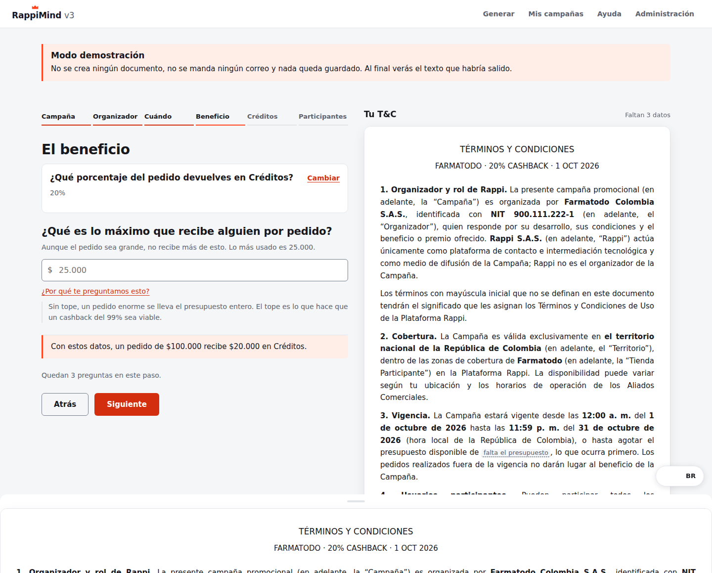

`docs/capturas/revision/12-pregunta-tope.png`

**Qué hace el comercial aquí.** Escribe el máximo de Créditos que puede recibir una persona por pedido. Abajo aparece la calculadora con un ejemplo.

**Lo que dice la pantalla:**

```
Campaña
Organizador
Cuándo
Beneficio
Créditos
Participantes
El beneficio
¿Qué porcentaje del pedido devuelves en Créditos?
Cambiar

20%

¿Qué es lo máximo que recibe alguien por pedido?

Aunque el pedido sea grande, no recibe más de esto. Lo más usado es 25.000.

$
¿Por qué te preguntamos esto?

Sin tope, un pedido enorme se lleva el presupuesto entero. El tope es lo que hace que un cashback del 99% sea viable.

Con estos datos, un pedido de $100.000 recibe $20.000 en Créditos.

Quedan 3 preguntas en este paso.

Atrás
Siguiente
Tu T&C
Faltan 3 datos
[aquí va la vista previa del documento, que no se revisa]
```


### 13. Formulario, el presupuesto

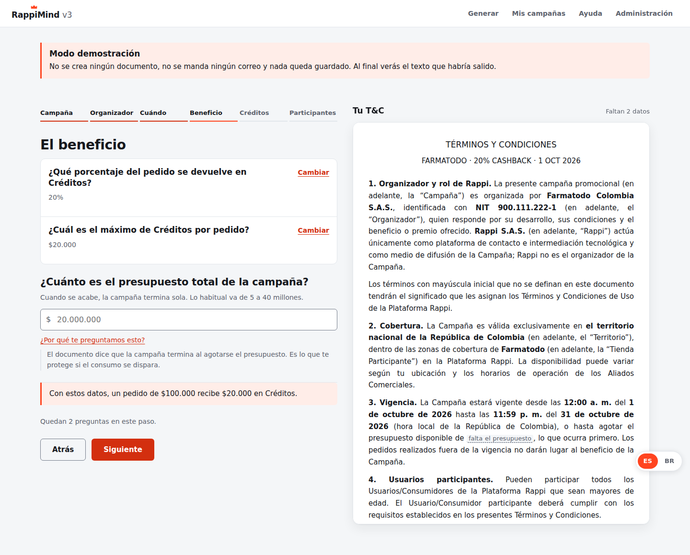

`docs/capturas/revision/13-pregunta-presupuesto.png`

**Qué hace el comercial aquí.** Escribe la plata total de la campaña. Cuando se agota, la campaña termina sola y el documento lo dice.

**Lo que dice la pantalla:**

```
Campaña
Organizador
Cuándo
Beneficio
Créditos
Participantes
El beneficio
¿Qué porcentaje del pedido devuelves en Créditos?
Cambiar

20%

¿Qué es lo máximo que recibe alguien por pedido?
Cambiar

$20.000

¿Cuánto es el presupuesto total de la campaña?

Cuando se acabe, la campaña termina sola. Lo habitual va de 5 a 40 millones.

$
¿Por qué te preguntamos esto?

El documento dice que la campaña termina al agotarse el presupuesto. Es lo que te protege si el consumo se dispara.

Con estos datos, un pedido de $100.000 recibe $20.000 en Créditos.

Quedan 2 preguntas en este paso.

Atrás
Siguiente
Tu T&C
Faltan 2 datos
[aquí va la vista previa del documento, que no se revisa]
```


### 14. Formulario, cuántas veces puede ganar

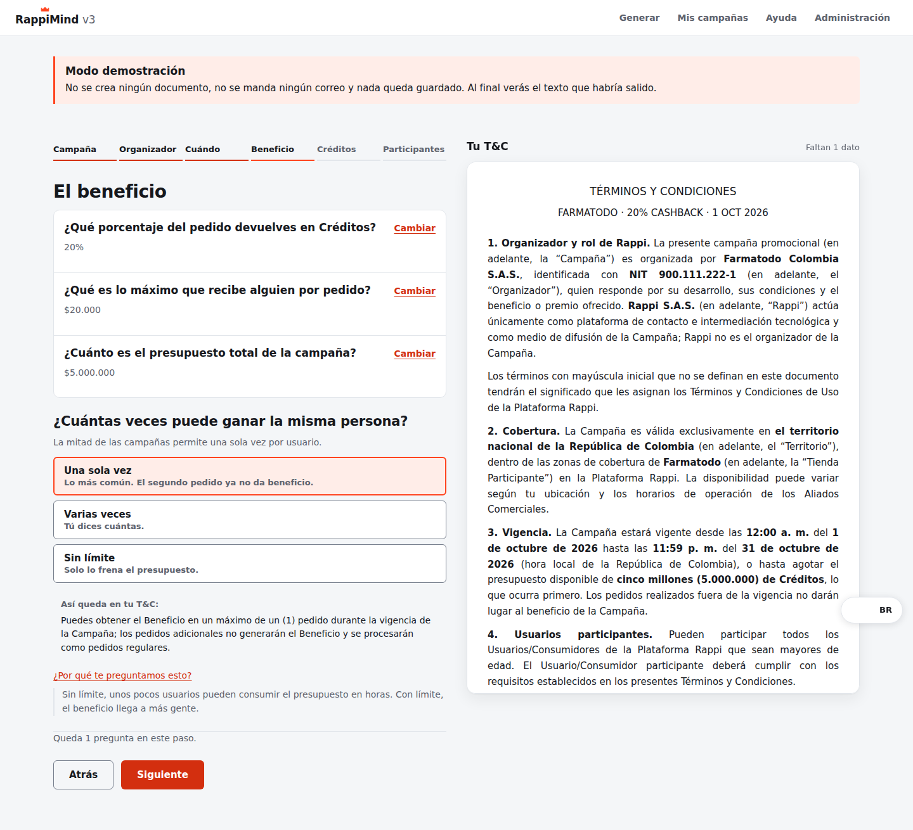

`docs/capturas/revision/14-pregunta-veces-por-persona.png`

**Qué hace el comercial aquí.** Elige si el beneficio se puede repetir por persona. Si elige varias veces, aparece un campo extra para decir cuántas.

**Lo que dice la pantalla:**

```
Campaña
Organizador
Cuándo
Beneficio
Créditos
Participantes
El beneficio
¿Qué porcentaje del pedido devuelves en Créditos?
Cambiar

20%

¿Qué es lo máximo que recibe alguien por pedido?
Cambiar

$20.000

¿Cuánto es el presupuesto total de la campaña?
Cambiar

$5.000.000

¿Cuántas veces puede ganar la misma persona?

La mitad de las campañas permite una sola vez por usuario.

Una sola vez
Lo más común. El segundo pedido ya no da beneficio.
Varias veces
Tú dices cuántas.
Sin límite
Solo lo frena el presupuesto.
Así queda en tu T&C:
Puedes obtener el Beneficio en un máximo de un (1) pedido durante la vigencia de la Campaña; los pedidos adicionales no generarán el Beneficio y se procesarán como pedidos regulares.
¿Por qué te preguntamos esto?

Sin límite, unos pocos usuarios pueden consumir el presupuesto en horas. Con límite, el beneficio llega a más gente.

Queda 1 pregunta en este paso.

Atrás
Siguiente
Tu T&C
Faltan 1 dato
[aquí va la vista previa del documento, que no se revisa]
```


### 15. Formulario, el tipo de pedido

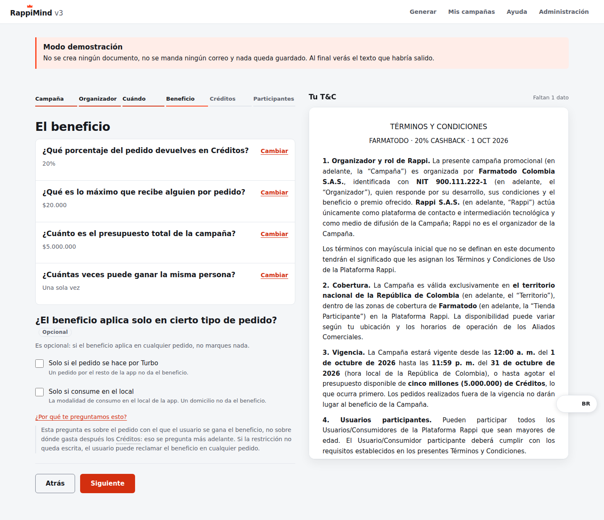

`docs/capturas/revision/15-pregunta-condiciones.png`

**Qué hace el comercial aquí.** Puede restringir el beneficio a cierto tipo de pedido. Es opcional y puede seguir sin marcar nada.

**Lo que dice la pantalla:**

```
Campaña
Organizador
Cuándo
Beneficio
Créditos
Participantes
El beneficio
¿Qué porcentaje del pedido devuelves en Créditos?
Cambiar

20%

¿Qué es lo máximo que recibe alguien por pedido?
Cambiar

$20.000

¿Cuánto es el presupuesto total de la campaña?
Cambiar

$5.000.000

¿Cuántas veces puede ganar la misma persona?
Cambiar

Una sola vez

¿El beneficio aplica solo en cierto tipo de pedido?Opcional

Es opcional: si el beneficio aplica en cualquier pedido, no marques nada.

Solo si el pedido se hace por Turbo
Un pedido por el resto de la app no da el beneficio.
Solo si consume en el local
La modalidad de consumo en el local de la app. Un domicilio no da el beneficio.
¿Por qué te preguntamos esto?

Esta pregunta es sobre el pedido con el que el usuario se gana el beneficio, no sobre dónde gasta después los Créditos: eso se pregunta más adelante. Si la restricción no queda escrita, el usuario puede reclamar el beneficio en cualquier pedido.

Atrás
Siguiente
Tu T&C
Faltan 1 dato
[aquí va la vista previa del documento, que no se revisa]
```


### 16. Formulario, cuándo llegan los Créditos

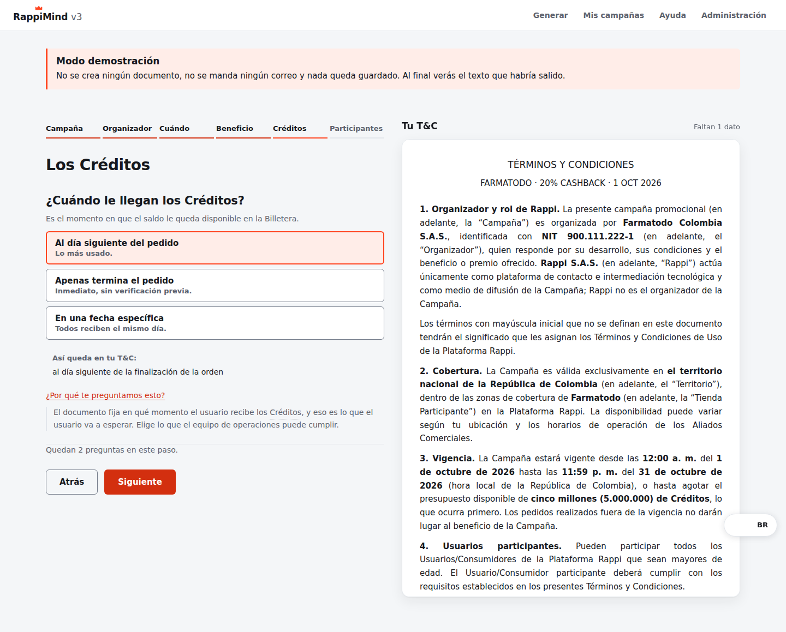

`docs/capturas/revision/16-pregunta-carga-de-creditos.png`

**Qué hace el comercial aquí.** Elige en qué momento se le acreditan los Créditos al usuario.

**Lo que dice la pantalla:**

```
Campaña
Organizador
Cuándo
Beneficio
Créditos
Participantes
Los Créditos
¿Cuándo le llegan los Créditos?

Es el momento en que el saldo le queda disponible en la Billetera.

Al día siguiente del pedido
Lo más usado.
Apenas termina el pedido
Inmediato, sin verificación previa.
En una fecha específica
Todos reciben el mismo día.
Así queda en tu T&C:
al día siguiente de la finalización de la orden
¿Por qué te preguntamos esto?

El documento fija en qué momento el usuario recibe los Créditos, y eso es lo que el usuario va a esperar. Elige lo que el equipo de operaciones puede cumplir.

Quedan 2 preguntas en este paso.

Atrás
Siguiente
Tu T&C
Faltan 1 dato
[aquí va la vista previa del documento, que no se revisa]
```


### 17. Formulario, hasta cuándo sirven los Créditos

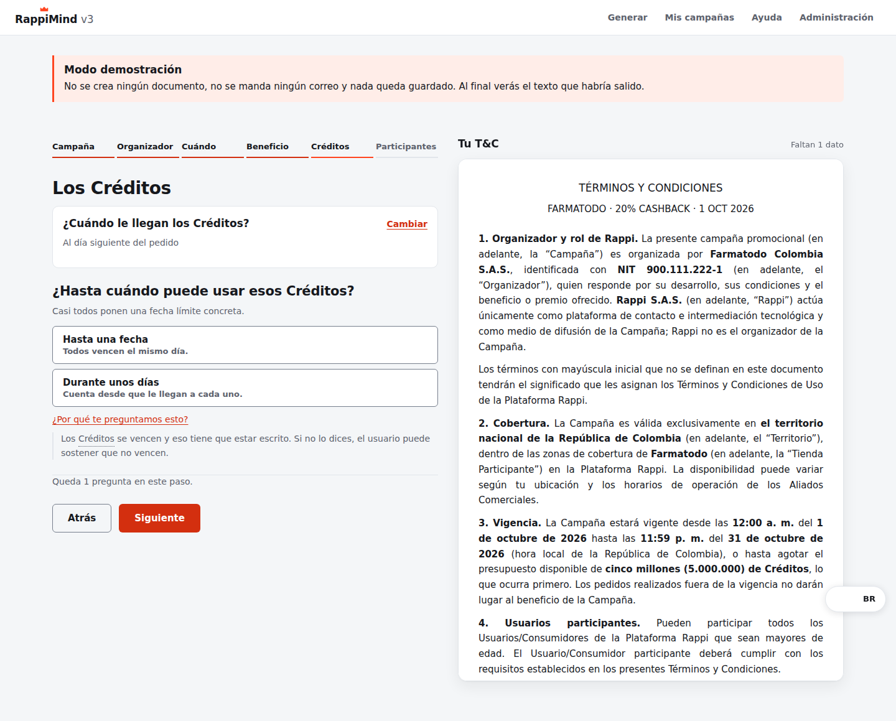

`docs/capturas/revision/17-pregunta-vigencia-de-creditos.png`

**Qué hace el comercial aquí.** Elige hasta cuándo puede gastarlos. Según lo que responda, la herramienta le pide después una fecha o un número de días.

**Lo que dice la pantalla:**

```
Campaña
Organizador
Cuándo
Beneficio
Créditos
Participantes
Los Créditos
¿Cuándo le llegan los Créditos?
Cambiar

Al día siguiente del pedido

¿Hasta cuándo puede usar esos Créditos?

Casi todos ponen una fecha límite concreta.

Hasta una fecha
Todos vencen el mismo día.
Durante unos días
Cuenta desde que le llegan a cada uno.
¿Por qué te preguntamos esto?

Los Créditos se vencen y eso tiene que estar escrito. Si no lo dices, el usuario puede sostener que no vencen.

Queda 1 pregunta en este paso.

Atrás
Siguiente
Tu T&C
Faltan 1 dato
[aquí va la vista previa del documento, que no se revisa]
```


### 18. Formulario, dónde se gastan los Créditos

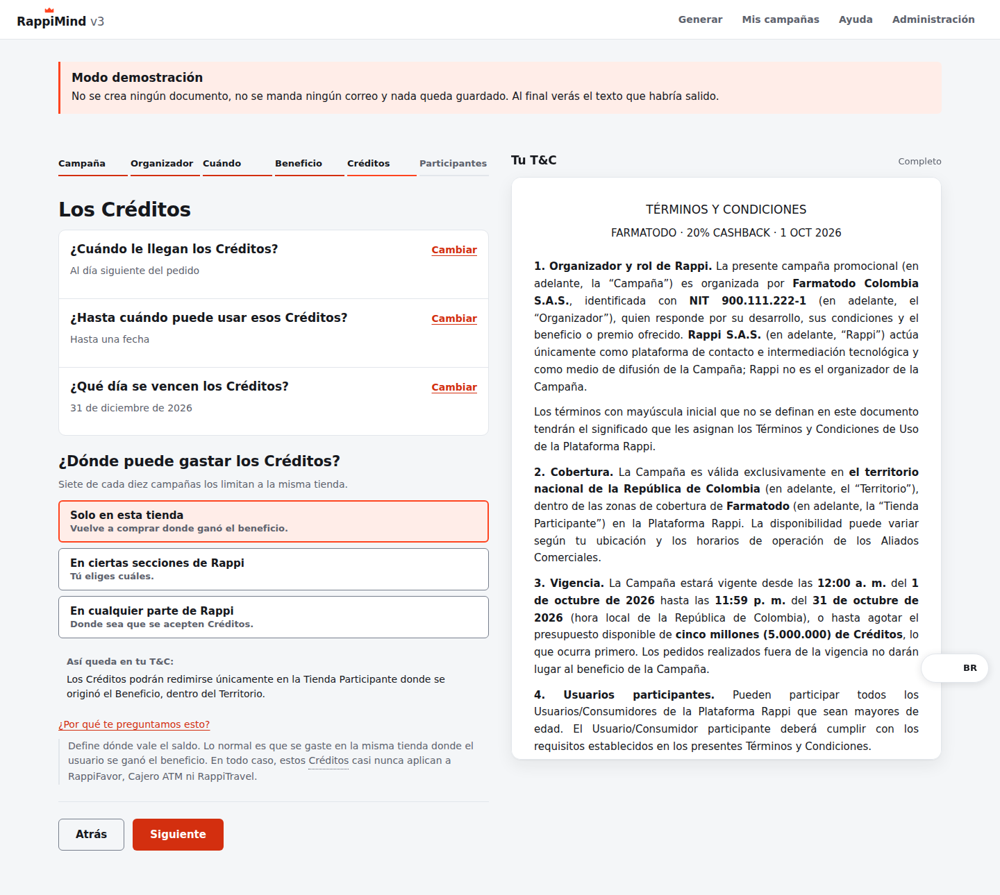

`docs/capturas/revision/18-pregunta-donde-se-gastan.png`

**Qué hace el comercial aquí.** Elige en qué parte de la app se pueden usar esos Créditos.

**Lo que dice la pantalla:**

```
Campaña
Organizador
Cuándo
Beneficio
Créditos
Participantes
Los Créditos
¿Cuándo le llegan los Créditos?
Cambiar

Al día siguiente del pedido

¿Hasta cuándo puede usar esos Créditos?
Cambiar

Hasta una fecha

¿Qué día se vencen los Créditos?
Cambiar

31 de diciembre de 2026

¿Dónde puede gastar los Créditos?

Siete de cada diez campañas los limitan a la misma tienda.

Solo en esta tienda
Vuelve a comprar donde ganó el beneficio.
En ciertas secciones de Rappi
Tú eliges cuáles.
En cualquier parte de Rappi
Donde sea que se acepten Créditos.
Así queda en tu T&C:
Los Créditos podrán redimirse únicamente en la Tienda Participante donde se originó el Beneficio, dentro del Territorio.
¿Por qué te preguntamos esto?

Define dónde vale el saldo. Lo normal es que se gaste en la misma tienda donde el usuario se ganó el beneficio. En todo caso, estos Créditos casi nunca aplican a RappiFavor, Cajero ATM ni RappiTravel.

Atrás
Siguiente
Tu T&C
Completo
[aquí va la vista previa del documento, que no se revisa]
```


### 19. Formulario, quién participa

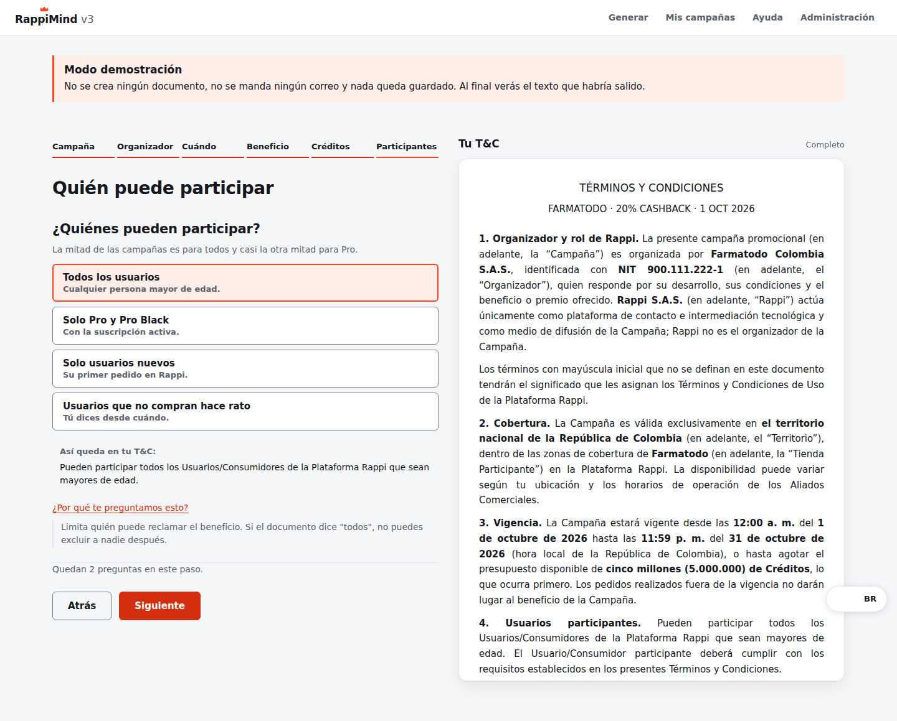

`docs/capturas/revision/19-pregunta-segmento.png`

**Qué hace el comercial aquí.** Elige a qué usuarios les aplica la campaña.

**Lo que dice la pantalla:**

```
Campaña
Organizador
Cuándo
Beneficio
Créditos
Participantes
Quién puede participar
¿Quiénes pueden participar?

La mitad de las campañas es para todos y casi la otra mitad para Pro.

Todos los usuarios
Cualquier persona mayor de edad.
Solo Pro y Pro Black
Con la suscripción activa.
Solo usuarios nuevos
Su primer pedido en Rappi.
Usuarios que no compran hace rato
Tú dices desde cuándo.
Así queda en tu T&C:
Pueden participar todos los Usuarios/Consumidores de la Plataforma Rappi que sean mayores de edad.
¿Por qué te preguntamos esto?

Limita quién puede reclamar el beneficio. Si el documento dice "todos", no puedes excluir a nadie después.

Quedan 2 preguntas en este paso.

Atrás
Siguiente
Tu T&C
Completo
[aquí va la vista previa del documento, que no se revisa]
```


### 20. Formulario, el medio de pago

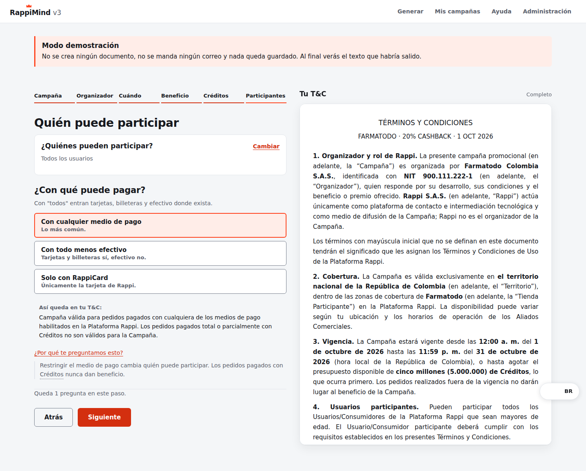

`docs/capturas/revision/20-pregunta-medio-de-pago.png`

**Qué hace el comercial aquí.** Elige con qué medios de pago aplica el beneficio.

**Lo que dice la pantalla:**

```
Campaña
Organizador
Cuándo
Beneficio
Créditos
Participantes
Quién puede participar
¿Quiénes pueden participar?
Cambiar

Todos los usuarios

¿Con qué puede pagar?

Con "todos" entran tarjetas, billeteras y efectivo donde exista.

Con cualquier medio de pago
Lo más común.
Con todo menos efectivo
Tarjetas y billeteras sí, efectivo no.
Solo con RappiCard
Únicamente la tarjeta de Rappi.
Así queda en tu T&C:
Campaña válida para pedidos pagados con cualquiera de los medios de pago habilitados en la Plataforma Rappi. Los pedidos pagados total o parcialmente con Créditos no son válidos para la Campaña.
¿Por qué te preguntamos esto?

Restringir el medio de pago cambia quién puede participar. Los pedidos pagados con Créditos nunca dan beneficio.

Queda 1 pregunta en este paso.

Atrás
Siguiente
Tu T&C
Completo
[aquí va la vista previa del documento, que no se revisa]
```


### 21. Formulario, la compra mínima

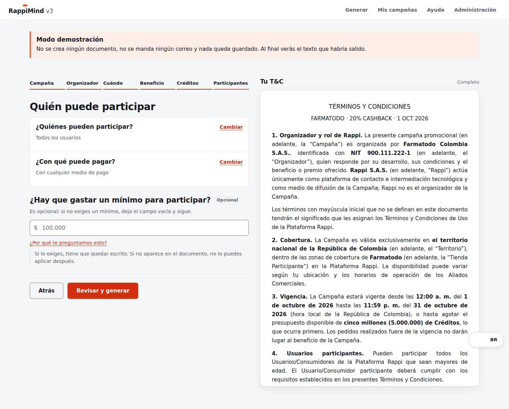

`docs/capturas/revision/21-pregunta-compra-minima.png`

**Qué hace el comercial aquí.** Última pregunta del formulario y la única marcada como opcional en este paso. Puede dejarla vacía y seguir. El botón ya no dice Siguiente sino Revisar y generar.

**Lo que dice la pantalla:**

```
Campaña
Organizador
Cuándo
Beneficio
Créditos
Participantes
Quién puede participar
¿Quiénes pueden participar?
Cambiar

Todos los usuarios

¿Con qué puede pagar?
Cambiar

Con cualquier medio de pago

¿Hay que gastar un mínimo para participar?Opcional

Es opcional: si no exiges un mínimo, deja el campo vacío y sigue.

$
¿Por qué te preguntamos esto?

Si lo exiges, tiene que quedar escrito. Si no aparece en el documento, no lo puedes aplicar después.

Atrás
Revisar y generar
Tu T&C
Completo
[aquí va la vista previa del documento, que no se revisa]
```


### 22. Resumen, con algo pendiente

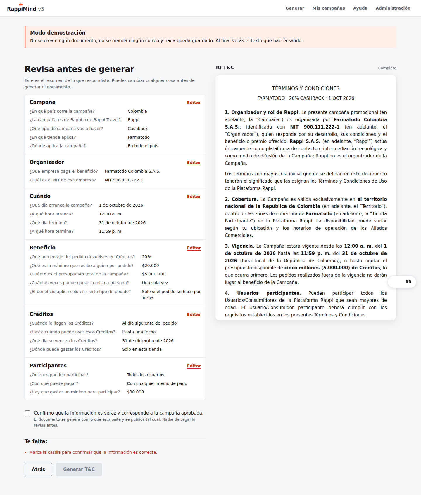

`docs/capturas/revision/22-resumen.png`

**Qué hace el comercial aquí.** Revisa todo lo que respondió, agrupado por paso, y puede editar cualquier grupo. Mientras falte algo, el botón de generar está deshabilitado y la lista "Te falta" dice qué es, en palabras.

**Lo que dice la pantalla:**

```
Revisa antes de generar

Este es el resumen de lo que respondiste. Puedes cambiar cualquier cosa antes de generar el documento.

Campaña
Editar
¿En qué país corre la campaña?
Colombia
¿La campaña es de Rappi o de Rappi Travel?
Rappi
¿Qué tipo de campaña vas a hacer?
Cashback
¿En qué tienda aplica?
Farmatodo
¿Dónde aplica la campaña?
En todo el país
Organizador
Editar
¿Qué empresa paga el beneficio?
Farmatodo Colombia S.A.S.
¿Cuál es el NIT de esa empresa?
NIT 900.111.222-1
Cuándo
Editar
¿Qué día arranca la campaña?
1 de octubre de 2026
¿A qué hora arranca?
12:00 a. m.
¿Qué día termina?
31 de octubre de 2026
¿A qué hora termina?
11:59 p. m.
Beneficio
Editar
¿Qué porcentaje del pedido devuelves en Créditos?
20%
¿Qué es lo máximo que recibe alguien por pedido?
$20.000
¿Cuánto es el presupuesto total de la campaña?
$5.000.000
¿Cuántas veces puede ganar la misma persona?
Una sola vez
¿El beneficio aplica solo en cierto tipo de pedido?
Solo si el pedido se hace por Turbo
Créditos
Editar
¿Cuándo le llegan los Créditos?
Al día siguiente del pedido
¿Hasta cuándo puede usar esos Créditos?
Hasta una fecha
¿Qué día se vencen los Créditos?
31 de diciembre de 2026
¿Dónde puede gastar los Créditos?
Solo en esta tienda
Participantes
Editar
¿Quiénes pueden participar?
Todos los usuarios
¿Con qué puede pagar?
Con cualquier medio de pago
¿Hay que gastar un mínimo para participar?
$30.000
Confirmo que la información es veraz y corresponde a la campaña aprobada.
El documento se genera con lo que escribiste y se publica tal cual. Nadie de Legal lo revisa antes.
Te falta:
Marca la casilla para confirmar que la información es correcta.
Atrás
Generar T&C
Tu T&C
Completo
[aquí va la vista previa del documento, que no se revisa]
```


### 23. Resumen, ya completo

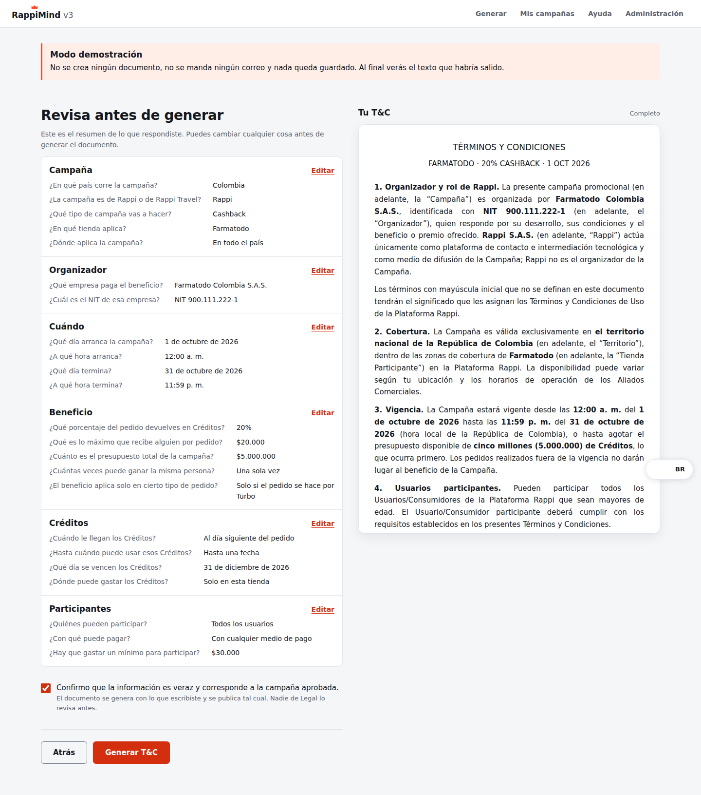

`docs/capturas/revision/23-resumen-declaracion.png`

**Qué hace el comercial aquí.** La misma pantalla con la declaración marcada. Con eso se habilita el botón de generar.

**Lo que dice la pantalla:**

```
Revisa antes de generar

Este es el resumen de lo que respondiste. Puedes cambiar cualquier cosa antes de generar el documento.

Campaña
Editar
¿En qué país corre la campaña?
Colombia
¿La campaña es de Rappi o de Rappi Travel?
Rappi
¿Qué tipo de campaña vas a hacer?
Cashback
¿En qué tienda aplica?
Farmatodo
¿Dónde aplica la campaña?
En todo el país
Organizador
Editar
¿Qué empresa paga el beneficio?
Farmatodo Colombia S.A.S.
¿Cuál es el NIT de esa empresa?
NIT 900.111.222-1
Cuándo
Editar
¿Qué día arranca la campaña?
1 de octubre de 2026
¿A qué hora arranca?
12:00 a. m.
¿Qué día termina?
31 de octubre de 2026
¿A qué hora termina?
11:59 p. m.
Beneficio
Editar
¿Qué porcentaje del pedido devuelves en Créditos?
20%
¿Qué es lo máximo que recibe alguien por pedido?
$20.000
¿Cuánto es el presupuesto total de la campaña?
$5.000.000
¿Cuántas veces puede ganar la misma persona?
Una sola vez
¿El beneficio aplica solo en cierto tipo de pedido?
Solo si el pedido se hace por Turbo
Créditos
Editar
¿Cuándo le llegan los Créditos?
Al día siguiente del pedido
¿Hasta cuándo puede usar esos Créditos?
Hasta una fecha
¿Qué día se vencen los Créditos?
31 de diciembre de 2026
¿Dónde puede gastar los Créditos?
Solo en esta tienda
Participantes
Editar
¿Quiénes pueden participar?
Todos los usuarios
¿Con qué puede pagar?
Con cualquier medio de pago
¿Hay que gastar un mínimo para participar?
$30.000
Confirmo que la información es veraz y corresponde a la campaña aprobada.
El documento se genera con lo que escribiste y se publica tal cual. Nadie de Legal lo revisa antes.
Atrás
Generar T&C
Tu T&C
Completo
[aquí va la vista previa del documento, que no se revisa]
```


### 24. Listo

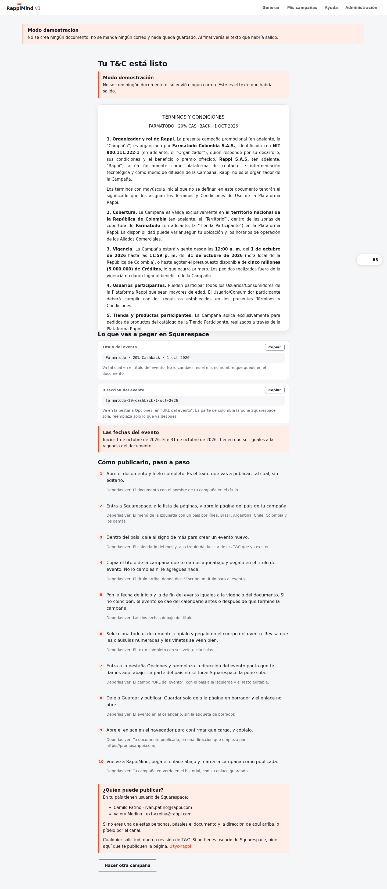

`docs/capturas/revision/24-listo.png`

**Qué hace el comercial aquí.** Es la pantalla donde el comercial deja la herramienta y se va a publicar. Recibe el documento, el título y la dirección listos para copiar, el paso a paso de Squarespace y la lista de quién puede publicar en su país.

**Lo que dice la pantalla:**

```
Tu T&C está listo
Modo demostración

No se creó ningún documento ni se envió ningún correo. Este es el texto que habría salido.

[aquí va el documento generado, que no se revisa]

Lo que vas a pegar en Squarespace
Título del evento
Copiar
Farmatodo · 20% Cashback · 1 oct 2026

Va tal cual en el título del evento. No lo cambies: es el mismo nombre que quedó en el documento.

Dirección del evento
Copiar
farmatodo-20-cashback-1-oct-2026

Va en la pestaña Opciones, en "URL del evento". La parte de colombia la pone Squarespace sola: reemplaza solo lo que va después.

Las fechas del evento

Inicio: 1 de octubre de 2026. Fin: 31 de octubre de 2026. Tienen que ser iguales a la vigencia del documento.

Cómo publicarlo, paso a paso

Abre el documento y léelo completo. Es el texto que vas a publicar, tal cual, sin editarlo.

Deberías ver: El documento con el nombre de tu campaña en el título.

Entra a Squarespace, a la lista de páginas, y abre la página del país de tu campaña.

Deberías ver: El menú de la izquierda con un país por línea: Brasil, Argentina, Chile, Colombia y los demás.

Dentro del país, dale al signo de más para crear un evento nuevo.

Deberías ver: El calendario del mes y, a la izquierda, la lista de los T&C que ya existen.

Copia el título de la campaña que te damos aquí abajo y pégalo en el título del evento. No lo cambies ni le agregues nada.

Deberías ver: El título arriba, donde dice "Escribe un título para el evento".

Pon la fecha de inicio y la de fin del evento iguales a la vigencia del documento. Si no coinciden, el evento se cae del calendario antes o después de que termine la campaña.

Deberías ver: Las dos fechas debajo del título.

Selecciona todo el documento, cópialo y pégalo en el cuerpo del evento. Revisa que las cláusulas numeradas y las viñetas se vean bien.

Deberías ver: El texto completo con sus veinte cláusulas.

Entra a la pestaña Opciones y reemplaza la dirección del evento por la que te damos aquí abajo. La parte del país no se toca: Squarespace la pone sola.

Deberías ver: El campo "URL del evento", con el país a la izquierda y el resto editable.

Dale a Guardar y publicar. Guardar solo deja la página en borrador y el enlace no abre.

Deberías ver: El evento en el calendario, sin la etiqueta de borrador.

Abre el enlace en el navegador para confirmar que carga, y cópialo.

Deberías ver: Tu documento publicado, en una dirección que empieza por https://promos.rappi.com/

Vuelve a RappiMind, pega el enlace abajo y marca la campaña como publicada.

Deberías ver: Tu campaña en verde en el historial, con su enlace guardado.

¿Quién puede publicar?

En tu país tienen usuario de Squarespace:

Camilo Patiño · ivan.patino@rappi.com
Valery Medina · ext-v.reina@rappi.com

Si no eres una de estas personas, pásales el documento y la dirección de aquí arriba, o pídelo por el canal.

Cualquier solicitud, duda o revisión de T&C. Si no tienes usuario de Squarespace, pide aquí que te publiquen la página. #tyc-rappi

Hacer otra campaña
```


### 25. Mis campañas

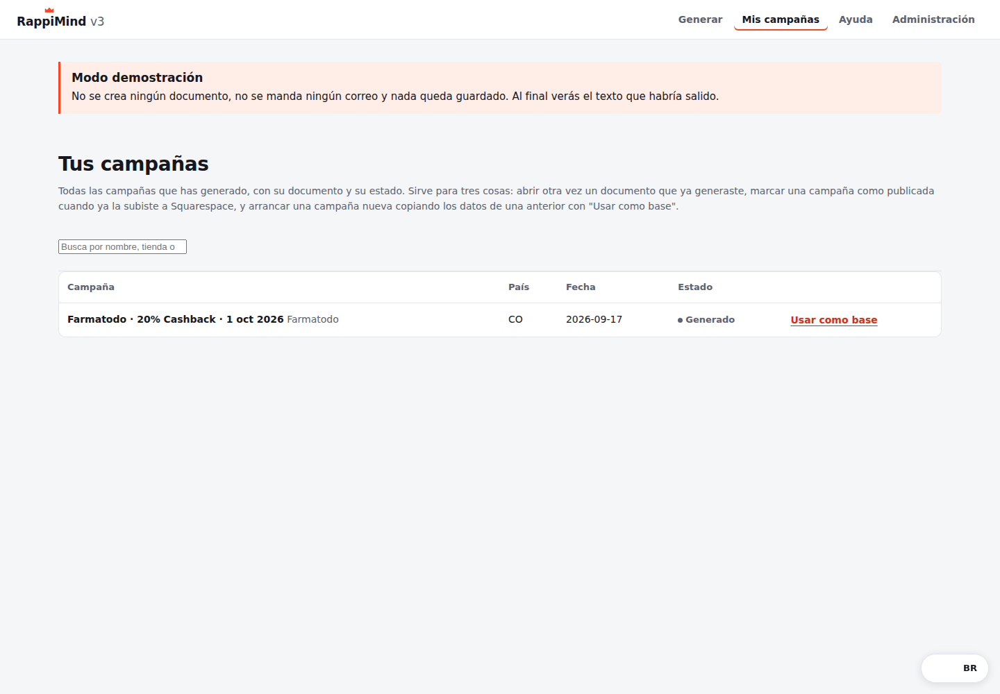

`docs/capturas/revision/25-mis-campanas.png`

**Qué hace el comercial aquí.** Busca sus campañas anteriores, abre otra vez un documento, marca una campaña como publicada o arranca una nueva copiando los datos de otra con "Usar como base".

**Lo que dice la pantalla:**

```
Tus campañas

Todas las campañas que has generado, con su documento y su estado. Sirve para tres cosas: abrir otra vez un documento que ya generaste, marcar una campaña como publicada cuando ya la subiste a Squarespace, y arrancar una campaña nueva copiando los datos de una anterior con "Usar como base".

Campaña	País	Fecha	Estado
Farmatodo · 20% Cashback · 1 oct 2026 Farmatodo	CO	2026-09-17
Generado	Usar como base
```


### 26. Ayuda

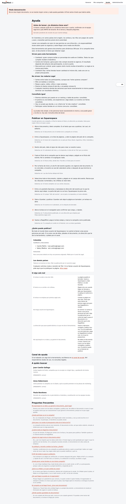

`docs/capturas/revision/26-ayuda.png`

**Qué hace el comercial aquí.** Consulta qué dinámicas sirven y cuáles no, cómo se publica en Squarespace, quién publica en cada país, qué hacer si algo sale mal, a quién escribirle y las preguntas frecuentes.

**Lo que dice la pantalla:**

```
Antes de lanzar: ¿tu dinámica tiene azar?

Si tienes cualquier duda de si tu dinámica tiene azar o suerte, confírmalo con el equipo legal de tu país ANTES de lanzarla. No la lances y después preguntes.

Borrador pendiente de revisión de Juan Camilo Gallego.

En Colombia y en varios países de la región, los sorteos y las rifas son juegos de suerte y azar y necesitan permiso previo de la autoridad.

Lanzar una campaña con azar sin ese permiso es una infracción, y la responsabilidad recae sobre quien la organiza y sobre Rappi como medio de difusión.

Esta herramienta solo genera documentos para dinámicas SIN azar. Si tu campaña tiene azar, el documento lo tiene que redactar Legal.

Sirven para esta herramienta
Cashback: quien compra recibe un porcentaje de vuelta en Créditos. Todos los que cumplen reciben el beneficio.
Carrera de Compras: gana quien más compre durante la vigencia. El resultado depende del esfuerzo del participante, no de la suerte.
Descuento por umbral: quien supere cierto monto recibe el beneficio. La regla es la misma para todos.
Cashback Day: varias tiendas hacen cashback el mismo día, cada una con su propio presupuesto.
No sirven: las redacta Legal
Sorteo entre todos los participantes, aunque sea "entre quienes compren".
Rifa con boletas o números.
Raspa y gana, ruleta, cofres o cajas sorpresa.
Premio al cliente número N del día, o al pedido número N.
Cualquier mecánica donde dos personas que hacen exactamente lo mismo pueden terminar con resultados distintos.
Consúltalo igual
Premios distintos por puesto en un ranking, o tabla de puntos: consúltalo.
El premio es una boleta, una experiencia o algo atado a un evento con fecha: consúltalo.
Hay un jurado que decide, o un criterio de "el más creativo": consúltalo.
Participan varias tiendas en un mismo concurso: consúltalo.

La prueba más simple: si dos personas hacen exactamente lo mismo y una puede ganar y la otra no, hay azar. Consulta antes de lanzar.

Publicar en Squarespace

Cuando generes una campaña, al final te damos el título y la dirección ya armados, listos para copiar. Esto es el paso a paso.

Abre el documento y léelo completo. Es el texto que vas a publicar, tal cual, sin editarlo.

Deberías ver: El documento con el nombre de tu campaña en el título.

Entra a Squarespace, a la lista de páginas, y abre la página del país de tu campaña.

Deberías ver: El menú de la izquierda con un país por línea: Brasil, Argentina, Chile, Colombia y los demás.

Dentro del país, dale al signo de más para crear un evento nuevo.

Deberías ver: El calendario del mes y, a la izquierda, la lista de los T&C que ya existen.

Copia el título de la campaña que te damos aquí abajo y pégalo en el título del evento. No lo cambies ni le agregues nada.

Deberías ver: El título arriba, donde dice "Escribe un título para el evento".

Pon la fecha de inicio y la de fin del evento iguales a la vigencia del documento. Si no coinciden, el evento se cae del calendario antes o después de que termine la campaña.

Deberías ver: Las dos fechas debajo del título.

Selecciona todo el documento, cópialo y pégalo en el cuerpo del evento. Revisa que las cláusulas numeradas y las viñetas se vean bien.

Deberías ver: El texto completo con sus veinte cláusulas.

Entra a la pestaña Opciones y reemplaza la dirección del evento por la que te damos aquí abajo. La parte del país no se toca: Squarespace la pone sola.

Deberías ver: El campo "URL del evento", con el país a la izquierda y el resto editable.

Dale a Guardar y publicar. Guardar solo deja la página en borrador y el enlace no abre.

Deberías ver: El evento en el calendario, sin la etiqueta de borrador.

Abre el enlace en el navegador para confirmar que carga, y cópialo.

Deberías ver: Tu documento publicado, en una dirección que empieza por https://promos.rappi.com/

Vuelve a RappiMind, pega el enlace abajo y marca la campaña como publicada.

Deberías ver: Tu campaña en verde en el historial, con su enlace guardado.

¿Quién puede publicar?

No todo el mundo tiene usuario de Squarespace: la cuenta la tienen unas pocas personas por país. Si no eres una de ellas, pásales el documento y la dirección que te dio la herramienta, o pídelo por el canal.

Colombia

Cashback y descuentos

Camilo Patiño · ivan.patino@rappi.com
Valery Medina · ext-v.reina@rappi.com

Concursos

Para concursos todavía no hay una persona asignada. Pídelo por el canal de Legal.

Los demás países

Todavía no tenemos la lista. Pide la publicación por el canal de Legal.

Cualquier solicitud, duda o revisión de T&C. Si no tienes usuario de Squarespace, pide aquí que te publiquen la página. #tyc-rappi

Si algo sale mal
El enlace no abre o da error 404.
La página quedó en borrador. Vuelve a Squarespace y dale Publicar, no solo Guardar.
El texto se ve corrido o sin viñetas.
Pégalo otra vez usando Pegar sin formato y deja que Squarespace le aplique el estilo de la página.
El enlace no empieza por promos.rappi.com.
Creaste la página en otro sitio. Tiene que estar dentro de promos.rappi.com para que RappiMind la acepte.
No tengo usuario de Squarespace.
Es normal: la cuenta la tienen unas pocas personas por país. Pide la publicación por el canal de Legal y pasa el documento y la dirección que te dio RappiMind.
La dirección que puse quedó distinta a la que me dio la herramienta.
Vuelve a Opciones, corrígela y publica otra vez. Si ya la publicaste con otra dirección, pega en RappiMind el enlace real, no el que te propusimos.
Me equivoqué en un dato y ya generé el documento.
No edites el documento a mano. Genera uno nuevo con los datos corregidos y publica ese. El anterior queda en tu historial sin publicar.
Canal de ayuda

Si te trabaste con algo de la herramienta, escríbenos en el canal de ayuda. Ahí respondemos dudas de uso, no consultas legales.

A quién buscar
Juan Camilo Gallego

Dudas legales de fondo, campañas que no encajan en ningún tipo, y aprobación de textos nuevos.

[PENDIENTE: correo]

Anna Habermann

Cómo plantear la campaña con el aliado y qué se puede prometer en las piezas de marketing.

[PENDIENTE: correo]

Paula Barahona

Revisión de campañas de un país distinto a Colombia y coordinación con los equipos locales.

[PENDIENTE: correo]

Preguntas frecuentes
Me equivoqué en un dato y ya generé el documento. ¿Qué hago?

Genera uno nuevo con los datos corregidos y publica ese. No edites el documento a mano: lo que se publica tiene que ser exactamente lo que generó la herramienta, porque es lo que Legal aprobó.

¿Puedo participar yo en la campaña?

No. Los empleados de Rappi y del Organizador están excluidos, y eso ya está escrito en el documento. Si participas, el beneficio se puede anular.

¿Qué pasa si se acaba el presupuesto antes de la fecha de fin?

La campaña termina sola en ese momento. El documento lo dice, así que estás cubierto. Avísale al aliado para que no siga pautando.

¿Cuánto tarda en llegarme el documento?

Un par de minutos. Te llega por correo con el enlace y los pasos para publicar. También queda en tu historial dentro de RappiMind.

¿Alguien de Legal revisa mi documento antes?

No, y por eso importa que los datos estén bien. El texto legal ya está aprobado por Legal: lo que tú aportas son los hechos. Si tu campaña necesita revisión, la herramienta te lo dice antes de empezar.

Ya publiqué y necesito cambiar las fechas. ¿Puedo?

Cambiar condiciones de una campaña ya publicada afecta a quien ya participó. Habla con Legal antes de tocar nada: hay reglas sobre qué se puede modificar y qué no.

El NIT del aliado no pasa la validación.

Casi siempre es el dígito de verificación, el número después del guion. Pídele el RUT a tu contacto y cópialo de ahí. Si el RUT dice un número y la validación lo rechaza, escríbele a Legal.

¿Puedo poner varias tiendas en una misma campaña?

Sí, con el tipo Cashback Day. Cada tienda entra con su razón social, su NIT y su presupuesto, porque cada una organiza su propio beneficio y responde por él.

¿Qué es un Maker y en qué cambia las cosas?

Es la marca que fabrica el producto, distinta de la tienda que lo vende. Si el Maker pone la plata, el Maker es el Organizador y va su razón social y su NIT, no los de la tienda.

¿Por qué Rappi no puede ser el organizador?

Porque Rappi es la plataforma que conecta, no quien vende ni quien fondea. El organizador es siempre la tienda o la marca que pone la plata. Que Rappi opere la mecánica o entregue el premio no lo cambia.

Mi campaña es de Rappi Travel. ¿Sirve esta herramienta?

Todavía no. Travel tiene otra entidad legal y su propio documento. La herramienta te manda al formulario de Legal en cuanto lo indicas.

¿Dónde quedan guardados los documentos?

En una carpeta de Drive por país, nunca en una carpeta general. Tú quedas como lector del documento y el enlace te llega por correo.
```


### 27. Legal

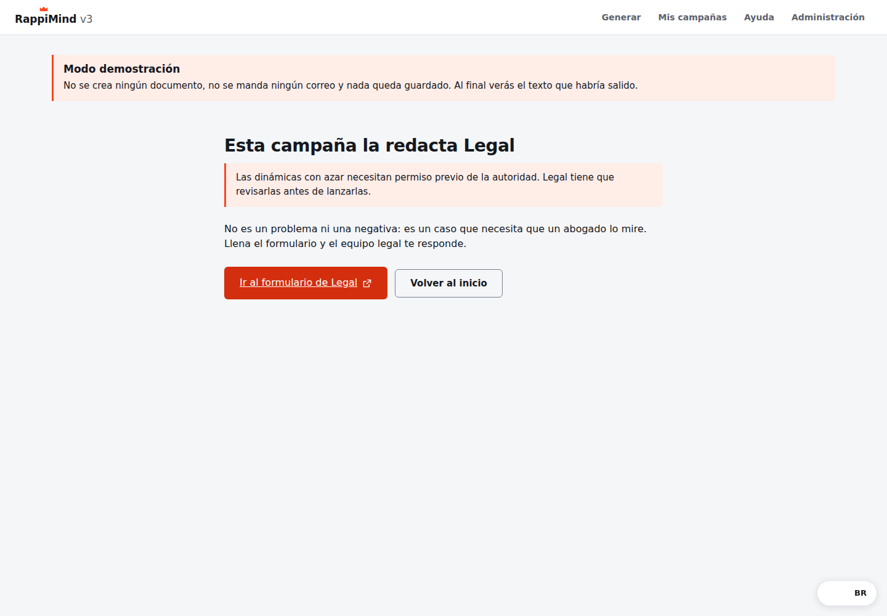

`docs/capturas/revision/27-legal.png`

**Qué hace el comercial aquí.** Es a donde llega cuando su caso lo tiene que redactar un abogado. Lee el motivo concreto y va al formulario de Legal.

**Lo que dice la pantalla:**

```
Esta campaña la redacta Legal

Las dinámicas con azar necesitan permiso previo de la autoridad. Legal tiene que revisarlas antes de lanzarlas.

No es un problema ni una negativa: es un caso que necesita que un abogado lo mire. Llena el formulario y el equipo legal te responde.

Ir al formulario de Legal
Volver al inicio
```


### 28. Filtro de Rappi Travel

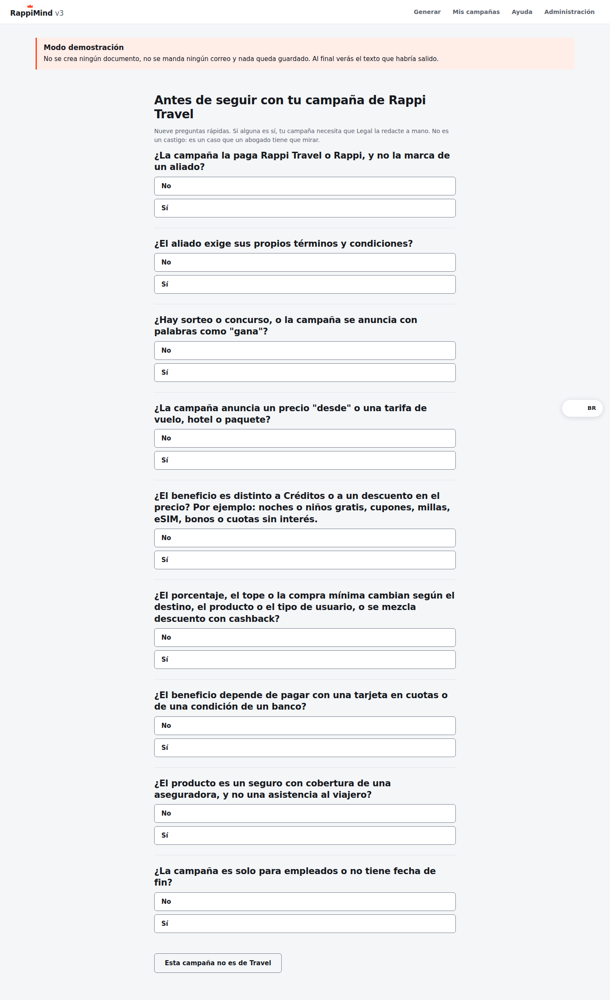

`docs/capturas/revision/28-filtro-travel.png`

**Qué hace el comercial aquí.** Solo lo ve quien eligió Rappi Travel. Responde nueve preguntas antes de poder elegir el tipo. Tiene una salida propia para quien entró por equivocación.

**Lo que dice la pantalla:**

```
Antes de seguir con tu campaña de Rappi Travel

Nueve preguntas rápidas. Si alguna es sí, tu campaña necesita que Legal la redacte a mano. No es un castigo: es un caso que un abogado tiene que mirar.

¿La campaña la paga Rappi Travel o Rappi, y no la marca de un aliado?
No
Sí
¿El aliado exige sus propios términos y condiciones?
No
Sí
¿Hay sorteo o concurso, o la campaña se anuncia con palabras como "gana"?
No
Sí
¿La campaña anuncia un precio "desde" o una tarifa de vuelo, hotel o paquete?
No
Sí
¿El beneficio es distinto a Créditos o a un descuento en el precio? Por ejemplo: noches o niños gratis, cupones, millas, eSIM, bonos o cuotas sin interés.
No
Sí
¿El porcentaje, el tope o la compra mínima cambian según el destino, el producto o el tipo de usuario, o se mezcla descuento con cashback?
No
Sí
¿El beneficio depende de pagar con una tarjeta en cuotas o de una condición de un banco?
No
Sí
¿El producto es un seguro con cobertura de una aseguradora, y no una asistencia al viajero?
No
Sí
¿La campaña es solo para empleados o no tiene fecha de fin?
No
Sí
Esta campaña no es de Travel
```


### 29. Formulario, el tipo de campaña de Rappi Travel

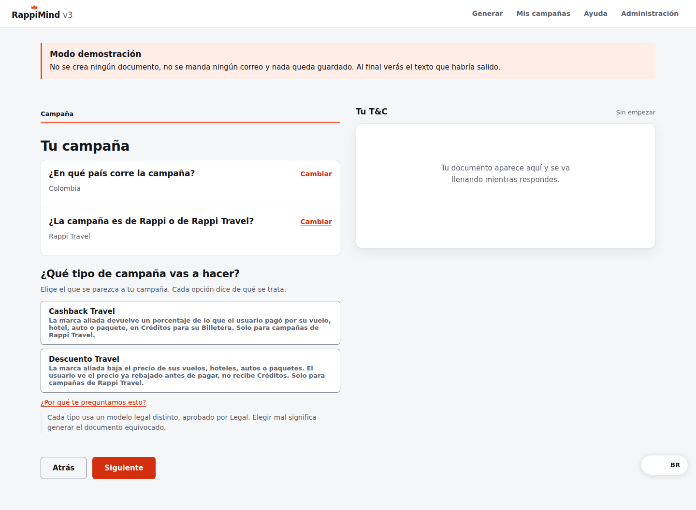

`docs/capturas/revision/29-tipos-travel.png`

**Qué hace el comercial aquí.** Después de pasar el filtro vuelve al formulario, con la pregunta del tipo abierta y solo los tipos de Travel.

**Lo que dice la pantalla:**

```
Campaña
Tu campaña
¿En qué país corre la campaña?
Cambiar

Colombia

¿La campaña es de Rappi o de Rappi Travel?
Cambiar

Rappi Travel

¿Qué tipo de campaña vas a hacer?

Elige el que se parezca a tu campaña. Cada opción dice de qué se trata.

Cashback Travel
La marca aliada devuelve un porcentaje de lo que el usuario pagó por su vuelo, hotel, auto o paquete, en Créditos para su Billetera. Solo para campañas de Rappi Travel.
Descuento Travel
La marca aliada baja el precio de sus vuelos, hoteles, autos o paquetes. El usuario ve el precio ya rebajado antes de pagar, no recibe Créditos. Solo para campañas de Rappi Travel.
¿Por qué te preguntamos esto?

Cada tipo usa un modelo legal distinto, aprobado por Legal. Elegir mal significa generar el documento equivocado.

Atrás
Siguiente
Tu T&C
Sin empezar
[aquí va la vista previa del documento, que no se revisa]
```


### 30. Inicio, interfaz en portugués

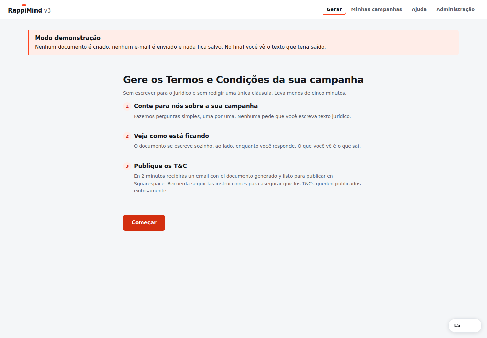

`docs/capturas/revision/30-inicio-portugues.png`

**Qué hace el comercial aquí.** La misma pantalla de inicio después de tocar BR en el selector de idioma, abajo a la derecha. Cambia el idioma de la interfaz, no el del documento.

**Lo que dice la pantalla:**

```
Gere os Termos e Condições da sua campanha

Sem escrever para o Jurídico e sem redigir uma única cláusula. Leva menos de cinco minutos.

Conte para nós sobre a sua campanha

Fazemos perguntas simples, uma por uma. Nenhuma pede que você escreva texto jurídico.

Veja como está ficando

O documento se escreve sozinho, ao lado, enquanto você responde. O que você vê é o que sai.

Publique os T&C

En 2 minutos recibirás un email con el documento generado y listo para publicar en Squarespace. Recuerda seguir las instrucciones para asegurar que los T&Cs queden publicados exitosamente.

Começar
```


### 31. Filtro de entrada, interfaz en portugués

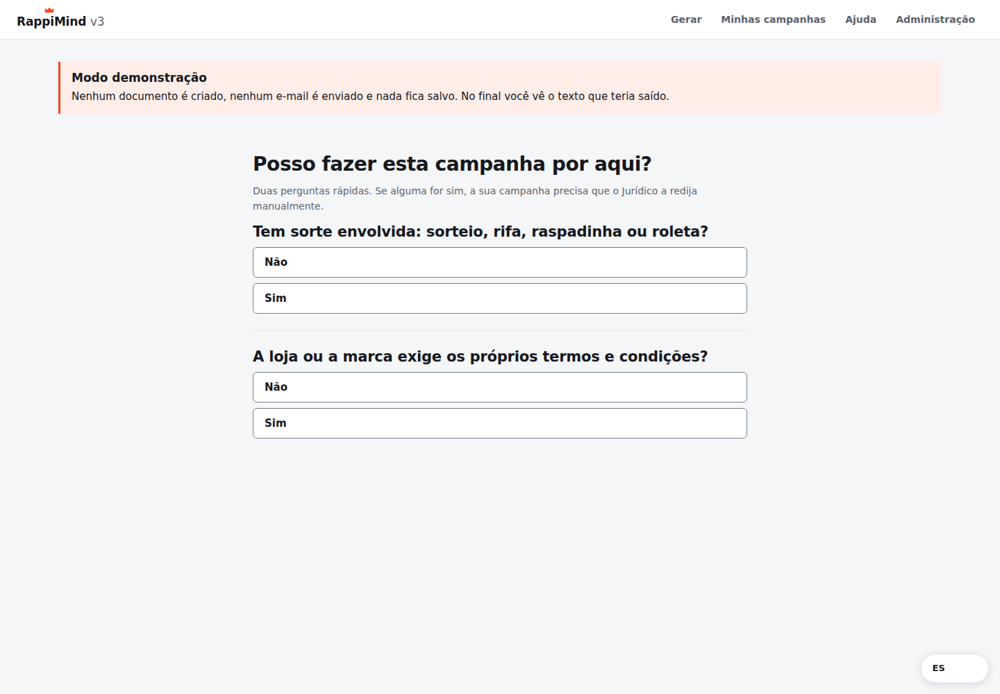

`docs/capturas/revision/31-filtro-portugues.png`

**Qué hace el comercial aquí.** Las dos preguntas generales con la interfaz en portugués.

**Lo que dice la pantalla:**

```
Posso fazer esta campanha por aqui?

Duas perguntas rápidas. Se alguma for sim, a sua campanha precisa que o Jurídico a redija manualmente.

Tem sorte envolvida: sorteio, rifa, raspadinha ou roleta?
Não
Sim
A loja ou a marca exige os próprios termos e condições?
Não
Sim
```


### 32. Formulario en portugués, el negocio

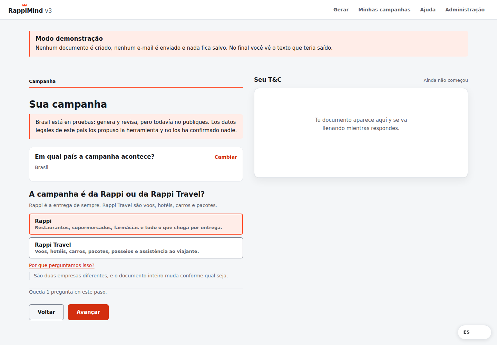

`docs/capturas/revision/32-pregunta-negocio-portugues.png`

**Qué hace el comercial aquí.** El formulario con la interfaz en portugués y Brasil como país, que está en piloto.

**Lo que dice la pantalla:**

```
Campanha
Sua campanha

Brasil está en pruebas: genera y revisa, pero todavía no publiques. Los datos legales de este país los propuso la herramienta y no los ha confirmado nadie.

Em qual país a campanha acontece?
Cambiar

Brasil

A campanha é da Rappi ou da Rappi Travel?

Rappi é a entrega de sempre. Rappi Travel são voos, hotéis, carros e pacotes.

Rappi
Restaurantes, supermercados, farmácias e tudo o que chega por entrega.
Rappi Travel
Voos, hotéis, carros, pacotes, passeios e assistência ao viajante.
Por que perguntamos isso?

São duas empresas diferentes, e o documento inteiro muda conforme qual seja.

Queda 1 pregunta en este paso.

Voltar
Avançar
Seu T&C
Ainda não começou
[aquí va la vista previa del documento, que no se revisa]
```


### 33. Formulario en portugués, el tipo de campaña

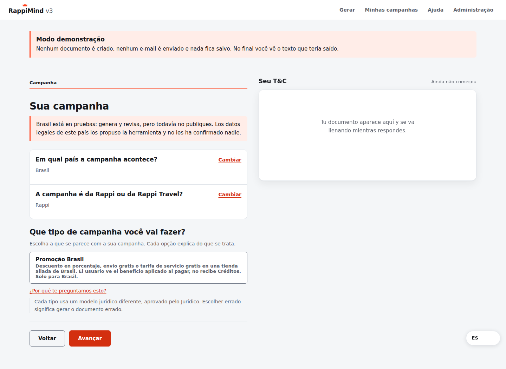

`docs/capturas/revision/33-tipos-portugues.png`

**Qué hace el comercial aquí.** Los tipos disponibles en Brasil, con la interfaz en portugués.

**Lo que dice la pantalla:**

```
Campanha
Sua campanha

Brasil está en pruebas: genera y revisa, pero todavía no publiques. Los datos legales de este país los propuso la herramienta y no los ha confirmado nadie.

Em qual país a campanha acontece?
Cambiar

Brasil

A campanha é da Rappi ou da Rappi Travel?
Cambiar

Rappi

Que tipo de campanha você vai fazer?

Escolha a que se parece com a sua campanha. Cada opção explica do que se trata.

Promoção Brasil
Descuento en porcentaje, envío gratis o tarifa de servicio gratis en una tienda aliada de Brasil. El usuario ve el beneficio aplicado al pagar, no recibe Créditos. Solo para Brasil.
¿Por qué te preguntamos esto?

Cada tipo usa um modelo jurídico diferente, aprovado pelo Jurídico. Escolher errado significa gerar o documento errado.

Voltar
Avançar
Seu T&C
Ainda não começou
[aquí va la vista previa del documento, que no se revisa]
```

## Lo que ya vimos al capturar

Esto no necesita que nadie lo descubra otra vez. Son cosas concretas que salieron al
recorrer la demostración el 17 de septiembre de 2026 y que conviene resolver en el
repositorio, no en la revisión de copy.

1. **La interfaz en portugués tiene textos que siguen en español.** En el inicio, el
   tercer paso ("En 2 minutos recibirás un email con el documento generado...") queda en
   español. En el formulario quedan en español "Cambiar", "Queda 1 pregunta en este
   paso.", "¿Por qué te preguntamos esto?" en la pantalla de tipos, el aviso de país en
   piloto de Brasil, la descripción del tipo "Promoção Brasil" y el texto de la vista
   previa vacía. El título del aviso de la demostración también.
2. **El botón del idioma elegido se ve en blanco sobre blanco.** En `src/client/estilos.css`
   la regla `.selector-idioma button[aria-pressed="true"]` usa `var(--marca)`, y esa
   variable no existe en la hoja: las que existen son `--naranja-marca` y
   `--naranja-accion`. Resultado: en español solo se ve `BR` y en portugués solo se ve
   `ES`, así que el selector parece un botón suelto y no una elección entre dos.
3. **En Mis campañas el campo de búsqueda es tan angosto que corta su propio texto de
   ayuda**: se lee "Busca por nombre, tienda o " y ahí se acaba.
4. **En Ayuda hay tres correos sin llenar**, escritos como `[PENDIENTE: correo]`, y la
   pantalla arranca con "Borrador pendiente de revisión de Juan Camilo Gallego."
5. **La Ayuda contradice al recorrido en Rappi Travel.** Una pregunta frecuente dice "Mi
   campaña es de Rappi Travel. ¿Sirve esta herramienta? Todavía no", pero el recorrido sí
   tiene Rappi Travel, con su filtro y dos tipos propios.
6. **La Ayuda nombra tipos con otro nombre.** Habla de "Cashback Day" y de "Descuento por
   umbral", y en la lista de tipos esos nombres no existen: el que se parece se llama
   "Cashback Multitienda".

## El prompt para Claude chat

Para pedir la revisión, abre una conversación nueva, adjunta este documento y las
capturas de `docs/capturas/revision/`, y pega esto:

```
Eres un especialista en experiencia de producto y en copy de producto en español.
Quiero que revises la interfaz de una herramienta interna antes de que la usen los
comerciales. Te adjunto un documento con una captura de cada pantalla y, debajo de
cada una, el texto completo que se ve en ella.

Qué es RappiMind, en tres frases:

1. Es una aplicación interna de Rappi donde un comercial (CAM o KAM) genera los
   Términos y Condiciones de su campaña de marketing sin escribirle al equipo legal.
2. La herramienta le hace preguntas sobre hechos (qué tienda, qué porcentaje, qué
   fechas, quién puede participar) y arma el documento con textos legales que el
   equipo legal ya aprobó, mientras él ve el documento llenándose al lado.
3. La persona del otro lado no es abogada, quiere lanzar su promoción esta semana, y
   cada pregunta que no entiende es una razón para cerrar la pestaña y escribirle a
   Legal, que es justo lo que esta herramienta existe para evitar.

Qué quiero que revises:

1. Claridad del copy para alguien que no es abogado. Palabras que un comercial no usa,
   frases largas, jerga legal innecesaria y cualquier lugar donde haya que leer dos
   veces para entender.
2. Preguntas ambiguas. Enunciados que se pueden responder de dos maneras distintas,
   opciones que se pisan entre sí, preguntas donde no queda claro qué dato exacto se
   está pidiendo o en qué unidad.
3. Ayudas que no ayudan. Cada pregunta tiene una línea de ayuda debajo y un
   desplegable "¿Por qué te preguntamos esto?". Dime cuáles repiten el enunciado en
   otras palabras, cuáles explican lo que ya era obvio y cuáles dejan sin responder la
   duda real que tendría el comercial.
4. Inconsistencias de tono entre pantallas. La herramienta a veces tutea, a veces
   explica, a veces advierte. Quiero saber dónde cambia el registro sin razón, dónde
   una misma idea se nombra de dos maneras distintas y dónde el tono se vuelve
   burocrático.
5. Si el recorrido se entiende sin explicación previa. Ponte en los zapatos de alguien
   que entra por primera vez, sin capacitación y sin manual: ¿sabe en qué punto está,
   cuánto le falta, qué pasa si se equivoca y por qué a veces lo mandan a Legal?
   Señala el primer momento en que se perdería.

Qué NO tienes que revisar:

- El texto legal de los documentos generados, es decir las cláusulas de los Términos y
  Condiciones. Ese texto es del equipo legal, ya está aprobado y no se toca. En el
  documento adjunto lo reemplazamos por una marca a propósito.
- La estética visual, los colores, la tipografía y la maquetación. Esta revisión es de
  palabras y de recorrido.
- Los datos de ejemplo de la campaña (Farmatodo, 20%, octubre de 2026): son inventados
  para la demostración.
- Cosas que ya sabemos y estamos arreglando: textos sin traducir en la interfaz en
  portugués, el botón de idioma que se ve mal, los correos pendientes en la pantalla de
  Ayuda y el campo de búsqueda angosto en Mis campañas.

Cómo quiero la respuesta:

- Ordenada por pantalla, con el número y el nombre tal como aparecen en el documento.
- Para cada hallazgo: la frase exacta que está hoy, qué problema tiene y una propuesta
  de reemplazo lista para pegar.
- Todo en español, con tono claro y directo, y sin usar guiones como signo de
  puntuación en los textos que propongas.
- Al final, las cinco cosas que cambiarías primero si solo se pudiera cambiar cinco.
```
